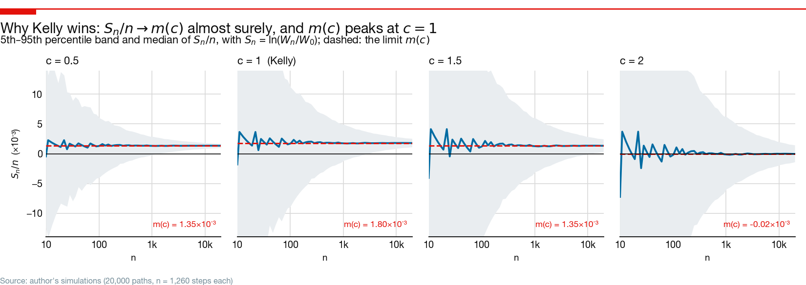
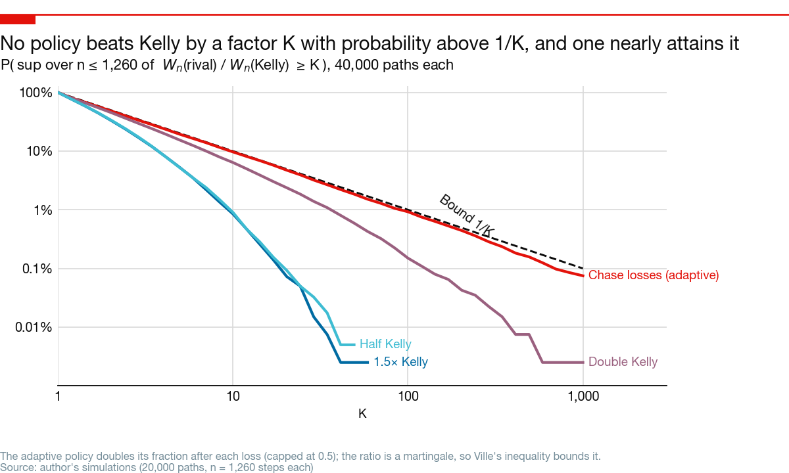
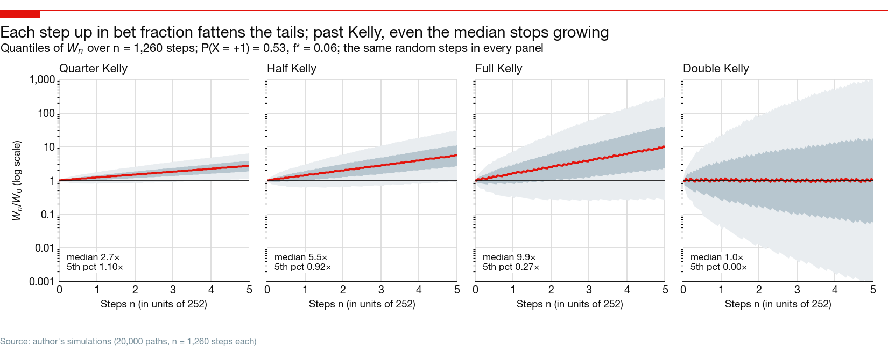
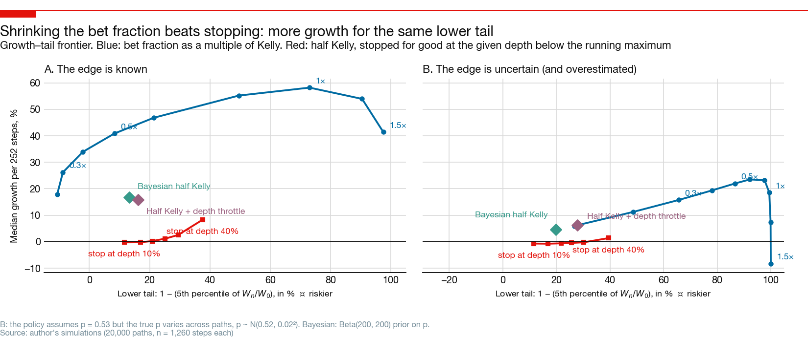
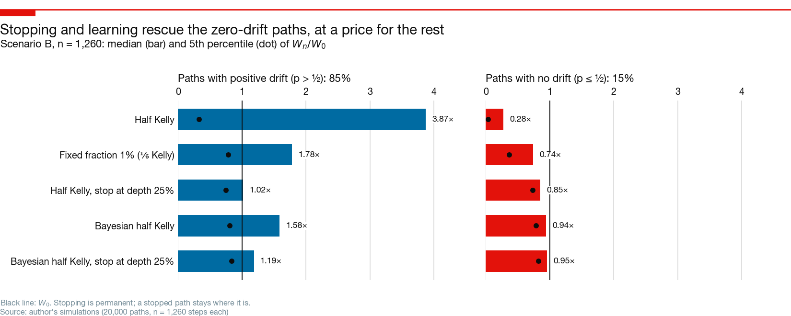

Take a coin that lands heads with probability slightly above one half. Before every toss you choose what fraction $$f$$ of the current value of a process to put on heads: a win multiplies the value by $$1+f$$, a loss by $$1-f$$. The expected change of each toss is positive, so the process drifts upward, but a long enough run of tails can push it arbitrarily low. This post treats that setting as a problem about a controlled stochastic process and asks four questions.

1. Which fraction $$f$$ makes the process grow fastest, and in what sense is it optimal?
2. What is the probability that the process ever falls to a given level?
3. How deep below its own running maximum does it go, and how does that depth grow with time?
4. What can a stopping time, such as "stop when the process reaches a barrier," do to these answers?

The answers use a handful of tools: the strong law of large numbers, the exponential martingale, optional stopping, and Wald's identity. Each result below is derived from them and then checked against a simulation of 20,000 sample paths. Section 10 describes the application to betting and trading, which is where the terms "Kelly" and "drawdown" come from.

**1. The process**

Let $$X_1, X_2, \dots$$ be i.i.d. with $$P(X=+1)=p$$ and $$P(X=-1)=q=1-p$$, where $$p>\tfrac12$$, so the drift is $$\mu = E[X] = 2p-1 > 0$$. A *policy* is a predictable sequence $$f_1, f_2, \dots \in [0,1)$$: $$f_n$$ may depend on $$X_1,\dots,X_{n-1}$$ but not on $$X_n$$. The controlled process is

$$W_n = W_{n-1}\,(1 + f_n X_n), \qquad W_0 > 0,$$

and its logarithm is the additive process

$$S_n = \ln\frac{W_n}{W_0} = \sum_{k=1}^n \ln(1+f_kX_k).$$

For a constant fraction $$f$$ the increments $$Y_k=\ln(1+fX_k)$$ are i.i.d., and $$S_n$$ is a random walk with mean $$m(f)=E[Y]$$ and variance $$s^2(f)=\mathrm{Var}(Y)$$. All the numbers in this post use $$p=0.53$$, so $$\mu=0.06$$. One "unit of time" is 252 steps.

**2. The growth rate and the Kelly fraction**

The mean increment of $$S_n$$ is

$$m(f) = p\ln(1+f) + q\ln(1-f).$$

Differentiate:

$$m'(f) = \frac{p}{1+f} - \frac{q}{1-f}, \qquad m''(f) = -\frac{p}{(1+f)^2} - \frac{q}{(1-f)^2} < 0.$$

So $$m$$ is strictly concave, and its unique maximum is at $$m'(f)=0$$: $$p(1-f) = q(1+f)$$, that is

$$f^* = p - q = \mu.$$

This is the **Kelly fraction**, here $$f^*=0.06$$. At the maximum, $$1+f^*=2p$$ and $$1-f^*=2q$$, so

$$m^* = m(f^*) = p\ln 2p + q \ln 2q = \ln 2 - H(p) = D\!\left(p \,\middle\|\, \tfrac12\right),$$

where $$H(p)$$ is the entropy of the coin and $$D$$ is the Kullback–Leibler divergence from the fair coin. The best growth rate equals the information the data carry about the bias. For $$p=0.53$$ it is $$m^* = 0.0018$$ per step.

For small $$f$$ expand $$\ln(1+fX) = fX - \tfrac12 f^2 X^2 + O(f^3)$$ and use $$X^2=1$$:

$$m(f) = \mu f - \tfrac12 f^2 + O(f^3), \qquad s^2(f) = \mathrm{Var}(fX) + O(f^3) = (1-\mu^2) f^2 + O(f^3) \approx f^2.$$

Write $$f = c f^*$$ for the fraction of Kelly, $$c \in [0, 2]$$. Then

$$m(c) = \mu^2\left(c - \tfrac{c^2}{2}\right) = m^* \, c(2-c), \qquad s^2(c) \approx c^2\mu^2 = 2m^*c^2, \qquad m^* \approx \tfrac12\mu^2.$$

Growth is a parabola in $$c$$, symmetric about $$c=1$$: half of Kelly keeps 75% of the maximal growth, and $$c=2$$ gives zero growth. The variance, by contrast, grows as $$c^2$$.

**3. Why Kelly is optimal**

There are three precise senses, each with a short proof.

*(a) Pathwise, by the law of large numbers.* For any constant fraction $$f$$, the strong law gives $$S_n/n \to m(f)$$ almost surely. Compare the Kelly process $$S^*_n$$ with the process $$S_n$$ for another constant $$f \neq f^*$$:

$$S^*_n - S_n = n\,\big(m^* - m(f)\big) + o(n) \to +\infty \quad \text{a.s.},$$

because $$m^* > m(f)$$ by strict concavity. Eventually, and for ever after, the Kelly path is above the other one, by an amount that grows linearly. The figure shows $$S_n/n$$ settling onto $$m(c)$$ for four values of $$c$$.

*(b) Against every policy, by a martingale.* Let $$W^*_n$$ be the Kelly process and $$W_n$$ the process under *any* predictable policy $$f_n$$, driven by the same $$X_n$$. The ratio $$R_n = W_n/W^*_n = \prod_{k\le n} \frac{1+f_kX_k}{1+f^*X_k}$$ satisfies

$$E\!\left[\frac{1+f_nX_n}{1+f^*X_n}\,\middle|\,\mathcal F_{n-1}\right] = p\,\frac{1+f_n}{1+f^*} + q\,\frac{1-f_n}{1-f^*} = p\,\frac{1+f_n}{2p} + q\,\frac{1-f_n}{2q} = \frac{1+f_n}{2}+\frac{1-f_n}{2} = 1.$$

So $$R_n$$ is a nonnegative martingale with $$R_0=1$$, whatever the policy. Two consequences follow.

- By Jensen's inequality, $$E[\ln R_n] \le \ln E[R_n] = 0$$, that is $$E[\ln W_n] \le E[\ln W^*_n]$$. Kelly maximizes the expected logarithm at *every* $$n$$, among all predictable policies, not only asymptotically.
- By Ville's maximal inequality, for every $$K>1$$,

$$P\Big(\sup_{n} R_n \ge K\Big) \le \frac1K.$$

*Proof of Ville's inequality.* Let $$\sigma = \inf\{n: R_n \ge K\}$$. By optional stopping at the bounded time $$\sigma\wedge N$$, $$1 = E[R_{\sigma\wedge N}] \ge K\,P(\sigma \le N)$$. Let $$N\to\infty$$. $$\square$$

So no policy can ever get ahead of Kelly by a factor $$K$$ with probability above $$1/K$$. The figure tests this with an adaptive "chase losses" policy that doubles its fraction after every loss (capped at 0.5): its sup-ratio exceeds $$K=10$$ with probability 9.7%, almost exactly the bound of 10%, because $$R_n$$ can overshoot $$K$$ only slightly. The constant fractions (half, 1.5 and 2 times Kelly) stay well below the bound.

*(c) Fastest to reach a high level, by a supermartingale.* For any predictable policy, $$E[\ln(1+f_nX_n)\mid\mathcal F_{n-1}] = m(f_n) \le m^*$$, so $$S_n - m^*n$$ is a supermartingale. Let $$\tau_a = \inf\{n: S_n \ge a\}$$, with $$E[\tau_a]<\infty$$. Optional stopping gives $$E[S_{\tau_a}] \le m^* E[\tau_a]$$. Since $$S_{\tau_a}\ge a$$,

$$E[\tau_a] \ge \frac{a}{m^*}.$$

Kelly attains this bound up to the overshoot at the barrier (Wald's identity, Section 5), so it minimizes the expected time to reach any high level, to first order in $$a$$.

Optimality here means *growth*. It says nothing about the variance of that growth, which the next sections quantify.

**4. The probability of falling to a given level**

Fix a constant fraction. The moment generating function $$\varphi(\lambda) = E[e^{-\lambda Y}]$$ is convex, with $$\varphi(0)=1$$ and $$\varphi'(0)=-m<0$$. And $$\varphi(\lambda)\to\infty$$ as $$\lambda\to\infty$$, because $$Y$$ takes the negative value $$\ln(1-f)$$ with positive probability. So $$\varphi$$ dips below 1 and returns: there is a unique $$\lambda>0$$ with $$\varphi(\lambda)=1$$. For that $$\lambda$$,

$$M_n = e^{-\lambda S_n} = \prod_{k\le n} e^{-\lambda Y_k}$$

is a positive martingale, since $$E[M_n \mid \mathcal F_{n-1}] = M_{n-1}\varphi(\lambda) = M_{n-1}$$. Let $$T_b = \inf\{n : S_n \le -b\}$$. Optional stopping at $$T_b\wedge N$$ gives

$$1 = E[M_{T_b\wedge N}] \ge E\big[M_{T_b};\,T_b\le N\big] \ge e^{\lambda b}\,P(T_b\le N),$$

and letting $$N\to\infty$$,

$$P(T_b<\infty) \le e^{-\lambda b}.$$

This is Lundberg's inequality. It is an inequality only because the walk can overshoot below $$-b$$; for the continuous limit (a Brownian motion with drift) it is an equality. Writing $$x=e^{-b}$$, the probability that $$W_n$$ ever falls to $$x W_0$$ is about $$x^{\lambda}$$.

*The exponent.* Expand $$\varphi$$ around 0 using $$E[Y]=m$$ and $$\mathrm{Var}(Y)=s^2$$:

$$\varphi(\lambda) = 1 - \lambda m + \tfrac12\lambda^2(s^2+m^2) + O(\lambda^3) \approx 1 - \lambda m + \tfrac12\lambda^2 s^2.$$

Setting this equal to 1 gives $$\lambda \approx 2m/s^2$$. With the formulas of Section 2,

$$\lambda(c) \approx \frac{2\cdot m^* c(2-c)}{2m^* c^2} = \frac{2-c}{c}.$$

| Fraction $$c$$ of Kelly | 0.25 | 0.5 | 1 | 1.5 | 2 |
|---|---|---|---|---|---|
| Exponent $$\lambda$$ (exact root) | 7.01 | 3.00 | 1.00 | 0.33 | 0 |
| $$P(\text{ever fall to } \tfrac12 W_0) = 2^{-\lambda}$$ | 0.8% | 12.5% | 50% | 79% | 100% |

At $$c=2$$ the drift is zero, so the walk is recurrent and reaches every level with probability 1. At $$c=1$$ the probability of ever falling to half the start is 50%, even though $$S_n\to\infty$$ almost surely.

*The case without compounding.* Suppose each bet has a fixed size and nothing is reinvested, so the state is the additive walk $$Z_n = Z_{n-1} + X_n$$ started at $$Z_0 = w$$. The walk is skip-free, and $$(q/p)^{Z_n}$$ is a martingale, since $$E[(q/p)^X] = p\cdot\frac qp + q\cdot\frac pq = q + p = 1$$. Optional stopping at the hitting time $$T_0$$ of zero, with $$Z_{T_0}=0$$ exactly, gives the exact gambler's-ruin formula

$$P(T_0<\infty) = \left(\frac qp\right)^{w}.$$

For $$w=20$$ (a bet size of 5% of the start) this is $$0.8868^{20}=9.0\%$$. In the simulation, 8.7% of paths were absorbed at 0 within 1,260 steps. It falls exponentially in $$w$$: doubling $$w$$ squares the probability.

*Choosing the fraction under a hitting constraint.* Suppose we want to maximize growth subject to $$P(\text{ever fall to } xW_0) \le \pi$$. This requires $$\lambda(c) \ge \Lambda := \ln\pi/\ln x$$, that is $$(2-c)/c \ge \Lambda$$, or $$c \le 2/(1+\Lambda)$$. Since $$m(c)=m^*c(2-c)$$ is increasing on $$[0,1]$$, the constraint binds at the optimum, and

$$c_{\mathrm{opt}} = \frac{2}{1+\Lambda}.$$

So *fractional Kelly is the optimal constant policy under a hitting-probability constraint.* For $$\pi=5\%$$ and $$x=0.7$$, $$\Lambda = 8.4$$ and $$c_{\mathrm{opt}}=0.21$$.

**5. Two-sided exit and Wald's identity**

Now stop the walk when it first leaves an interval, $$\tau = \inf\{n: S_n \ge a \text{ or } S_n \le -b\}$$. Work in the continuous limit, in which the walk exits exactly at the boundary. Optional stopping applies to the martingale $$e^{-\lambda S_n}$$, which is bounded up to $$\tau$$. With $$P_b = P(S_\tau = -b)$$:

$$1 = E\big[e^{-\lambda S_\tau}\big] = P_b\, e^{\lambda b} + (1-P_b)\,e^{-\lambda a} \quad\Longrightarrow\quad P_b = \frac{1-e^{-\lambda a}}{e^{\lambda b}-e^{-\lambda a}}.$$

Letting $$a\to\infty$$ recovers $$e^{-\lambda b}$$ from Section 4.

For the expected exit time use **Wald's identity**: the process $$S_n - mn$$ is a martingale, so $$E[S_{\tau\wedge N}] = m\,E[\tau\wedge N]$$. Since $$\tau$$ has geometric tails, $$E[\tau]<\infty$$, and letting $$N\to\infty$$ (dominated convergence, increments bounded) gives $$E[S_\tau] = m\,E[\tau]$$. Therefore

$$E[\tau] = \frac{a(1-P_b) - b\,P_b}{m}.$$

The table tests both formulas for half Kelly ($$\lambda = 3.0$$, $$m = 0.00135$$) with a lower barrier at $$0.7W_0$$ and an upper barrier at the stated multiple of $$W_0$$.

| Upper barrier | $$P(\text{hit lower first})$$, theory / simulation | $$E[\tau]$$, theory / simulation |
|---|---|---|
| $$1.1\,W_0$$ | 11.5% / 12.1% | 32 / 39 |
| $$1.5\,W_0$$ | 26.8% / 26.0% | 149 / 160 |
| $$2\,W_0$$ | 31.3% / 30.3% | 270 / 284 |
| $$5\,W_0$$ | 34.0% / 32.8% | 697 / 720 |
| none | 34.2% / 33.0% | $$\infty$$ |

The simulated numbers sit a little below the formulas because a discrete step can jump over a barrier that a continuous path would have touched. The figure plots both checks: on the left, $$x^{\lambda}$$ against simulation for $$x=0.5$$ and $$0.7$$; on the right, the exit probability against the upper barrier.

**6. Excursions below the running maximum**

The probability in Section 4 measures the distance below the *starting* value. The more relevant quantity for a long run is the distance below the process's own running maximum. Let

$$M_n = \max_{k\le n} S_k, \qquad D_n = M_n - S_n \ge 0.$$

$$D_n$$ is the walk reflected at its maximum, and $$1-e^{-D_n}$$ is the relative depth of $$W_n$$ below its record (the drawdown). For a walk with positive drift $$D_n$$ is positive recurrent. It returns to 0 infinitely often, and it also reaches *every* finite level infinitely often with probability 1: the probability that $$D$$ *ever* exceeds $$d$$ is 1, not $$e^{-\lambda d}$$. What stays small is the rate at which deep excursions occur.

*Rate of deep excursions.* Start at a record. In the exit formula of Section 5 take the upper barrier to be a small $$\varepsilon$$ above the record and the lower barrier $$d$$ below it:

$$P(\text{drop } d \text{ before rising } \varepsilon) = \frac{1-e^{-\lambda\varepsilon}}{e^{\lambda d}-e^{-\lambda\varepsilon}} \approx \varepsilon\,\frac{\lambda}{e^{\lambda d}-1}.$$

So per unit of increase of the maximum, deep excursions occur at rate $$\lambda/(e^{\lambda d}-1)\approx \lambda e^{-\lambda d}$$. The process regenerates at each new record (strong Markov property), so excursions are independent, and their number up to time $$n$$ is approximately Poisson. The maximum grows at speed $$m$$, so $$M_n \approx mn$$, and the expected number of excursions of depth at least $$d$$ is

$$\Lambda_n(d) \approx \frac{m n\,\lambda}{e^{\lambda d}-1}.$$

Hence $$P(\max_{k\le n}D_k < d)\approx e^{-\Lambda_n(d)}$$, and the median of the maximum depth solves $$\Lambda_n(d)=\ln 2$$:

$$d_{\mathrm{med}}(n) \approx \frac1\lambda \ln\!\Big(1 + \frac{m n\lambda}{\ln 2}\Big).$$

The maximum depth grows like the *logarithm* of the time, at the scale $$1/\lambda$$. It never stops growing, but the pace slows, and shrinking the fraction $$c$$ cuts it through the exponent $$\lambda=(2-c)/c$$. The table compares $$1-e^{-d_{\mathrm{med}}}$$ with the simulated median of the maximum relative depth.

| Median maximum depth after $$n$$ steps | 252 | 1,260 | 2,520 | 5,040 | 10,080 |
|---|---|---|---|---|---|
| Quarter Kelly, theory / simulation | 15% / 18% | 29% / 30% | 35% / 36% | 41% / 41% | 47% / 46% |
| Half Kelly | 26% / 34% | 51% / 53% | 60% / 61% | 68% / 68% | 74% / 74% |
| Full Kelly | 40% / 59% | 77% / 82% | 87% / 89% | 93% / 94% | 96% / 96% |

The regenerative approximation is accurate from about a thousand steps on. At short horizons it underestimates, because the first excursions start from the initial point, where the maximum moves faster than $$mn$$.

**7. What a stopping time can do**

A stopping time $$\tau$$ is a rule that uses only the past. Wald's identity of Section 5 holds for all of them, and for any predictable policy Section 3(c) gives the matching inequality:

$$E[S_\tau] \le m^*\,E[\tau].$$

*A stopping time cannot create growth.* The expected log-growth is at most $$m^*$$ per step of exposure. All a stopping time does is reduce the number of steps. Two examples show how the trade works.

*Upper barrier.* Stopping when the process first reaches $$1.1W_0$$ (first row of the Section 5 table) reduces the probability of ever touching $$0.7W_0$$ from 34% to 11.5%. But $$E[\tau]=32$$ steps: the risk fell because the process was exposed for 32 steps on average instead of indefinitely.

*Stopping at a fixed depth.* Let $$T_d=\inf\{n: D_n\ge d\}$$, the first time the process is a distance $$d$$ below its running maximum. By Section 6, $$P(T_d>n)\approx e^{-\Lambda_n(d)}$$, so $$T_d$$ is almost surely finite, and for large $$n$$ it is approximately exponential with mean $$(e^{\lambda d}-1)/(m\lambda)$$. For half Kelly and a relative depth of 25% ($$d=\ln\frac{1}{0.75}$$) the formula gives a mean of 338 steps. In the simulation the mean was 159 steps (early excursions are faster), and 99.995% of the 20,000 paths had stopped by $$n=1{,}260$$. A permanent stop at a fixed depth, applied to a process whose drift is known, therefore ends the process almost surely, at a growth cost that Section 9 measures.

**8. When the drift is unknown**

Everything so far assumed that $$p$$ is known. If $$p$$ is unknown, a loss is evidence, and a stopping time becomes a *sequential test*.

*Wald's SPRT.* Test $$H_0: p=\tfrac12$$ (no drift) against $$H_1: p=p_1$$. The log-likelihood ratio $$L_n=\sum_{k\le n}\ell(X_k)$$, with $$\ell(+1)=\ln 2p_1$$ and $$\ell(-1)=\ln 2q_1$$, has

$$E_0\big[e^{\ell(X)}\big] = \tfrac12\cdot 2p_1 + \tfrac12\cdot 2q_1 = 1,$$

so $$e^{L_n}$$ is a martingale under $$H_0$$. Ville's inequality (as in Section 3) then bounds the false-alarm probability: $$P_0(\sup_n L_n \ge A) \le e^{-A}$$. Under $$H_1$$ the increments of $$L_n$$ have mean

$$E_1[\ell(X)] = p_1\ln 2p_1 + q_1\ln 2q_1 = D\!\left(p_1\,\middle\|\,\tfrac12\right) = m^*,$$

the same number as the Kelly growth rate in Section 2. By Wald's identity the expected time to detect the drift at false-alarm level $$e^{-A}$$ is $$E_1[\tau]\approx A/m^*$$. For $$p_1=0.53$$ and a 5% false-alarm level, $$A=\ln 20$$, and $$E_1[\tau] \approx 3.00/0.0018 \approx 1{,}660$$ steps, longer than the whole simulated horizon of 1,260. A small drift cannot be certified quickly: the information rate at which the data reveal the bias is exactly the rate at which the process can grow.

*Bayesian Kelly.* Put a Beta$$(a_0,a_0)$$ prior on $$p$$. After $$k$$ wins in $$n$$ steps, the posterior predictive probability of a win is $$\hat p_n = (a_0+k)/(2a_0+n)$$. Since $$\ln W_n=\sum_k\ln(1+f_kX_k)$$ is additive and the choice of $$f_k$$ does not change what is learned, the policy that maximizes $$E[\ln W_n]$$ is *myopic*: at each step maximize $$E[\ln(1+fX)\mid\mathcal F_{n-1}] = \hat p_n\ln(1+f)+(1-\hat p_n)\ln(1-f)$$. This has the same form as Section 2 with $$p$$ replaced by $$\hat p_n$$, so

$$f_n = \max(0,\,2\hat p_n - 1).$$

In the simulation below I scale this by $$\tfrac12$$ and use $$a_0=200$$ (a prior centered on no drift, worth 400 earlier steps). This policy is a soft stopping rule: it shrinks $$f_n$$ smoothly to 0 as the evidence for a drift weakens, rather than switching off at a threshold.

**9. Simulation study**

I simulated 20,000 paths of $$n=1{,}260$$ steps (5 "years" of 252) with the same random steps for every policy. In scenario A, $$p=0.53$$ is known exactly. In scenario B the policy assumes $$p=0.53$$ but the true value differs between paths, $$p\sim N(0.52,\,0.02^2)$$: 85% of paths have a positive drift and 15% have none or a negative one. Eleven policies were compared:

- *Fixed bet size*: a constant 0.05 $$W_0$$ per step, no reinvestment (the additive walk of Section 4).
- *Fixed fraction 1%*: $$f=0.01=\tfrac16 f^*$$.
- *Quarter, half, full* and *double Kelly*: $$f=c f^*$$ with $$c=\tfrac14,\tfrac12,1,2$$.
- *Half Kelly with a depth throttle*: $$f_n=\tfrac12 f^*\,(1-D_n^{\mathrm{rel}}/0.30)^+$$, where $$D_n^{\mathrm{rel}}=1-W_n/\max_{k\le n}W_k$$ is the relative depth below the running maximum. The fraction shrinks to 0 as the depth approaches 30%.
- *Half Kelly, stop at depth 25%*: stop for good when $$D^{\mathrm{rel}}_n\ge 0.25$$.
- *Half Kelly, exit band*: stop for good when $$W_n\le 0.7W_0$$ or $$W_n\ge 2W_0$$ (the two-barrier problem of Section 5).
- *Bayesian half Kelly* (Section 8), with and without the depth-25% stop.

The fans show the 5th to 95th percentile of $$W_n$$. Each increase of $$c$$ lifts the median and the upper tail, and drags the lower tail down. At $$c=1$$ the median reaches $$9.9W_0$$ but the 5th percentile is $$0.27W_0$$. At $$c=2$$ the drift is zero, the median stays near $$W_0$$, and 28% of paths fall at some time to $$0.01W_0$$ or below.

One sample path makes the same point. The three processes share every step, so they move together, but at full Kelly the path falls to 25% of its running maximum (a depth of 75%) in the second year, while quarter Kelly never goes deeper than 27%.

| Policy | Median $$W_n/W_0$$ | Median growth per 252 steps | 5th percentile $$W_n/W_0$$ | $$P(W_n<W_0)$$ | $$P(\text{depth}\ge 50\%)$$ |
|---|---|---|---|---|---|
| Fixed bet size 0.05 $$W_0$$ | 4.7 | 36% | 0.00 | 9.1% | 47% |
| Fixed fraction 1% | 2.0 | 15% | 1.10 | 2.8% | 0.2% |
| Quarter Kelly | 2.7 | 22% | 1.10 | 3.2% | 3.5% |
| Half Kelly | 5.5 | 41% | 0.92 | 5.7% | 60% |
| Full Kelly | 9.9 | 58% | 0.27 | 14% | 99.95% |
| Double Kelly | 1.03 | 0.5% | 0.00 | 49% | 100% |
| Half Kelly, depth throttle | 2.1 | 16% | 0.84 | 12% | 0% |
| Bayesian half Kelly | 2.2 | 17% | 0.87 | 13% | 21% |
| Half Kelly, stop at depth 25% | 1.06 | 1.2% | 0.75 | 44% | 0% |
| Half Kelly, exit band | 2.0 | 15% | 0.68 | 29% | 10% |
| Bayesian half Kelly, stop at depth 25% | 1.31 | 5.5% | 0.87 | 21% | 0% |

Four observations follow, and each matches the theory.

- **Growth and tails move together.** Median growth rises with $$c$$ up to $$c=1$$ (Section 2), but the 5th percentile and the depth probability get worse at every step (Sections 4 and 6). Full Kelly has a 99.95% chance of a depth of at least 50% within 1,260 steps, even though the chance of ever touching $$\tfrac12W_0$$ is only 50%: these are the two different probabilities of Sections 4 and 6.
- **A fixed depth-stop is almost certain to fire** when the drift is known (Section 7), and it ends the process at about its starting value: median growth falls from 41% to 1.2% per 252 steps.
- **Only the depth throttle caps the depth.** No path reached a depth of 30% (0 of 20,000), but at a cost in growth that sizing alone would not charge.
- **For the same lower tail, a smaller fraction beats stopping.** The frontier below compares the 5th percentile of $$W_n/W_0$$ with the median growth. The blue curve (varying $$c$$) is above the red curve (half Kelly stopped at depths of 10% to 40%) in both scenarios, by more than 30 points of growth in scenario A.

In scenario B the picture changes in one respect, which is the one the theory of Section 8 predicts. Splitting the paths by their true $$p$$:

Half Kelly sized to $$p=0.53$$ has median $$3.9W_0$$ on the paths with a positive drift and $$0.28W_0$$ on the paths with none (5th percentile $$0.03W_0$$). Stopping at depth 25% protects the zero-drift paths (median 0.85) but takes away nearly all the gain of the others (1.02). The Bayesian rule keeps 0.94 on the zero-drift paths and 1.6 on the others, because it shrinks $$f_n$$ as the posterior mean of $$p$$ moves toward $$\tfrac12$$ rather than waiting for a threshold. In the frontier panel for scenario B the Bayesian rule lies about on the curve of constant fractions, so learning the drift is not cheaper than shrinking $$f$$ for the same lower tail. What it adds is protection against the zero-drift paths. The constant-fraction curve peaks near $$c=0.6$$ of the *assumed* $$f^*$$. The average true drift (0.04) is below the assumed one (0.06), so the true Kelly fraction is about $$\tfrac23$$ of the assumed one, and the optimal $$c$$ moves left of 1.

**10. Application: betting and trading**

The mapping is direct. $$X_n$$ is the outcome of a bet or a trade with even odds. $$f_n$$ is the fraction of the bankroll or account put at risk. $$W_n$$ is the bankroll. A first passage below $$xW_0$$ is a ruin or loss limit, and the depth below the running maximum is the drawdown. The drift per step in units of its standard deviation is $$\mu/\sigma\approx 0.06$$; over 252 steps this is an annualized Sharpe ratio of $$0.06\sqrt{252}\approx 0.95$$, and the Kelly growth rate satisfies $$m^*\approx\tfrac12(\mu/\sigma)^2$$. In practice the results say:

- *Use a fraction of equity, not a fixed size.* The additive walk is absorbed at 0 with probability $$(q/p)^{w}$$ (Section 4), and a fixed fraction never is.
- *Use a fraction of Kelly, a half at most.* Section 3 makes Kelly optimal for growth, but the hitting exponent is $$\lambda=(2-c)/c$$, the 5th percentile falls sharply beyond $$c=\tfrac12$$, and in practice the estimated drift is noisy and biased upward. For a loss budget $$(\pi, x)$$, take $$c=2/(1+\ln\pi/\ln x)$$.
- *Expect drawdowns anyway.* The depth below the running maximum grows like $$\lambda^{-1}\ln n$$ (Section 6): at half Kelly the median is 34% after one year and 53% after five. Only a smaller $$c$$ reduces it.
- *Do not stop at a fixed depth when the drift is known.* The stop is certain to fire (Section 7), and it ends the growth.
- *Do stop, or shrink, on evidence that the drift is gone.* That is a sequential test (Section 8). A Bayesian fraction does it smoothly.
- *If a hard depth limit is required* (a margin or a mandate), a throttle that shrinks $$f_n$$ to 0 near the limit enforces it, at a price in growth.

*Limits.* The steps are i.i.d. with a constant $$p$$ and even odds. Real returns have heavy tails, serial dependence, costs and a drift that decays, all of which make deep excursions more likely than the exponents here suggest. The formulas are exact for the Brownian limit and approximate for a discrete walk: the hitting probability is an upper bound up to the overshoot constant, the excursion formula is accurate from about a thousand steps, and the quadratic expansion of Section 2 is accurate for small $$f$$. Scenario B models one form of uncertainty about $$p$$, and the Bayesian prior is a choice: a more optimistic one would learn faster.

*Reproducibility.* Full source code is available at
[github.com/chandlerzuo/chandlerzuo.github.io/tree/master/codes/kelly_risk](https://github.com/chandlerzuo/chandlerzuo.github.io/tree/master/codes/kelly_risk);
`run_all.sh` rebuilds all the numbers and figures in this post in about five minutes, with fixed random seeds. `sim.py` runs the eleven policies in both scenarios, the frontier sweeps, the checks of the hitting-probability and two-barrier formulas, the maximum-depth table, the law-of-large-numbers figure and the test of the competitive bound. `make_charts.py` draws the ten figures.

*(c)2017-2026 CHANDLER ZUO ALL RIGHTS PRESERVED*
