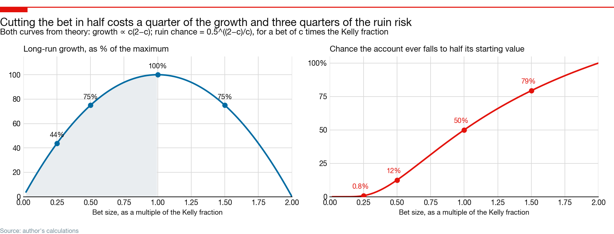
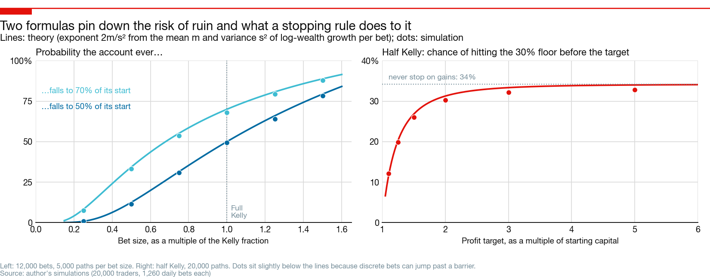
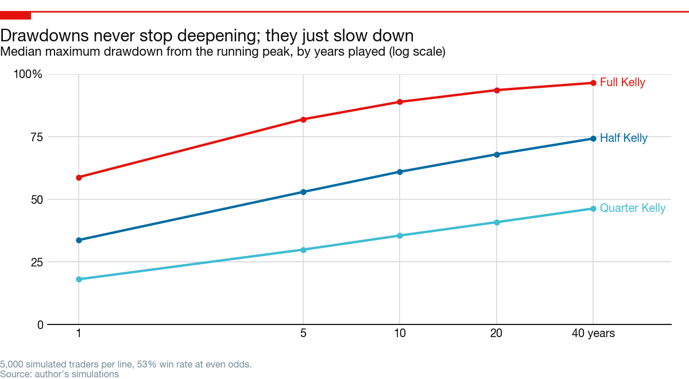
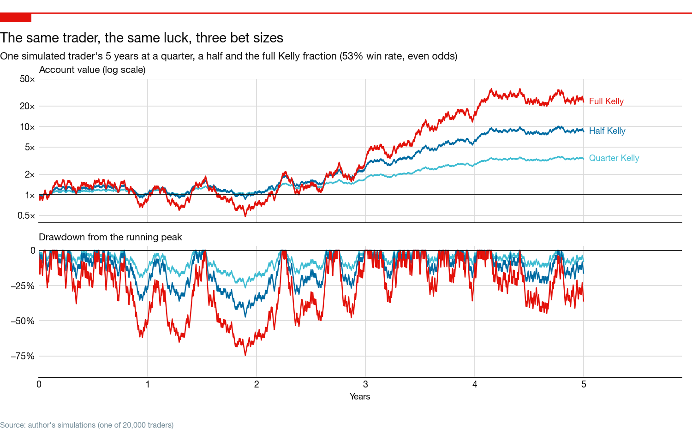
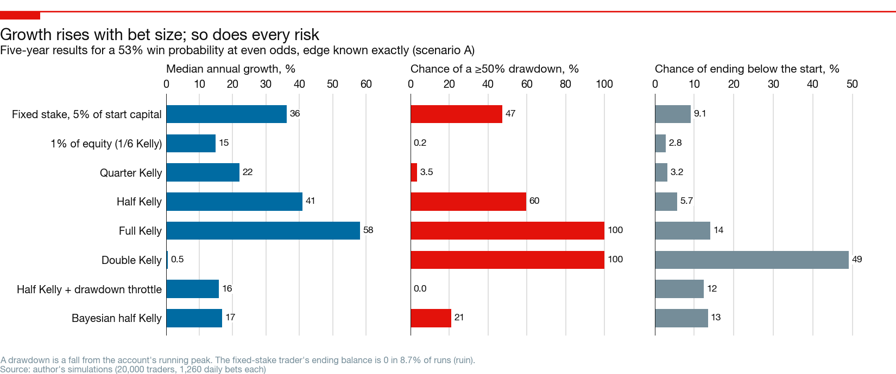

Suppose you play a game you win slightly more often than you lose, a poker session or a day-trading strategy. Your expected profit is positive, but each outcome is noisy. Play long enough and a bad run will eventually come along. So what is the chance it finishes you off, and what can you do about it?

The short answer is that the chance of ruin is not fixed by the game. It is set by how much you bet. Cut the bet in half and the chance of a given loss does not halve: it falls exponentially. This post works through the mathematics and then runs a simulation study of eleven sizing and stopping rules on 20,000 simulated traders. Three findings come out of it.

1. **Bet size matters more than anything else.** Betting the Kelly fraction maximizes growth but leaves you a 99.95% chance of a 50% drawdown within five years. A quarter of Kelly keeps about 38% of the growth rate (22% a year against 58%) and cuts that chance to 3.5%.
2. **Quitting is not a substitute for sizing.** When the edge is known, a rule such as "stop after a 25% drawdown" ends up stopping everyone, since drawdowns of that size are certain to come, and it throws away almost all the growth. The same risk is bought far more cheaply by shrinking the bet.
3. **A stopping rule earns its keep only when you are unsure that the edge exists.** Then a loss is evidence, and the stop works as a sequential hypothesis test. Sizing bets by what you have learned so far does the same job more gently.

**The game.** Each round you stake a fraction $$f$$ of your current wealth. You win the stake with probability $$p = 0.53$$ and lose it otherwise, at even odds. The edge per unit staked is $$\mu = 2p - 1 = 0.06$$ and the variance is $$\sigma^2 = 1 - \mu^2 \approx 1$$. If you play once a day, that is an annualized Sharpe ratio of $$0.06\sqrt{252} \approx 0.95$$, a good strategy, and about what a strong day trader might claim. After a bet, log-wealth moves by

$$Y = \ln(1+f) \text{ with probability } p, \qquad Y = \ln(1-f) \text{ with probability } 1-p.$$

Wealth compounds, so what grows linearly is log-wealth, and its mean per bet is $$m(f) = E[Y]$$. The Kelly fraction $$f^* = 2p - 1 = 6\%$$ is the one that maximizes $$m$$. Betting a fraction $$c$$ of Kelly, $$f = c f^*$$, gives, to a good approximation,

$$m(c) = m^* \, c(2-c), \qquad s^2(c) = 2 m^* c^2, \qquad m^* = \frac{\mu^2}{2\sigma^2} = 0.0018,$$

where $$s^2$$ is the variance of $$Y$$. Growth is a hump in $$c$$: it peaks at $$c=1$$, is already 75% of the peak at half Kelly, and falls to zero at $$c = 2$$. Going past Kelly is never worth it. Variance, by contrast, rises with the square of $$c$$.

**Fixed bets: ruin is finite but not small.** First take a gambler who stakes a fixed amount each time and never compounds. Starting with $$W$$ stakes, the chance of ever hitting zero is the classical gambler's-ruin result

$$P(\text{ruin}) = \left(\frac{1-p}{p}\right)^{W} \approx e^{-2\mu W/\sigma^2}.$$

With $$W = 20$$ stakes (each stake 5% of starting capital) this is $$0.8868^{20} = 9.0\%$$, and in the simulation 8.7% of traders were wiped out within five years. The formula says how ruin falls: exponentially in the bankroll measured in stakes. Doubling the bankroll, or halving the stake, squares the ruin probability, taking 9% to 0.8%.

**Betting a fraction: the account cannot reach zero, but it can fall a long way.** If you bet a fraction of equity, you can never hit exactly zero, so "ruin" has to be defined as a loss large enough to hurt. The same exponent governs it. Let $$\lambda$$ solve $$E[e^{-\lambda Y}] = 1$$. Then $$W_t^{-\lambda}$$ is a martingale, and the probability that the account ever falls to a fraction $$x$$ of its starting value is about $$x^{\lambda}$$, where for small bets $$\lambda \approx 2m/s^2 = (2-c)/c$$. At full Kelly $$\lambda = 1$$, so the chance of ever falling to half your starting capital is 50%. At half Kelly, $$\lambda = 3$$ and it is $$0.5^3 = 12.5\%$$. At a quarter of Kelly, $$\lambda = 7$$ and it is 0.8%. The left panel below checks this against simulation.

The formula inverts into a sizing rule. If you can tolerate at most a chance $$\pi$$ of ever losing a fraction $$1 - x$$ of your starting capital, then $$\lambda = \ln \pi / \ln x$$ and

$$c = \frac{2}{1 + \lambda}.$$

Take a 5% chance of ever losing 30%. Then $$\lambda = \ln 0.05 / \ln 0.7 = 8.4$$ and $$c = 0.21$$: bet about a fifth of Kelly.

**Drawdowns from the peak are a different matter.** That formula is about the distance below your *starting* wealth, and it is easily misread as a statement about drawdowns from the running peak. For the peak the infinite-horizon probability is not $$x^\lambda$$, it is 1: an account with positive drift keeps setting new highs, and from each high there is a fresh, small chance of a deep fall, so sooner or later one comes. What the formula does tell you is how fast the depth grows: the typical maximum drawdown rises with the logarithm of the time you play, at a pace of about $$1/\lambda$$ in log-wealth per $$e$$-fold of time. The simulation shows it.

| Median maximum drawdown after | 1 year | 5 years | 10 years | 20 years | 40 years |
|---|---|---|---|---|---|
| Quarter Kelly | 18% | 30% | 36% | 41% | 46% |
| Half Kelly | 34% | 53% | 61% | 68% | 74% |
| Full Kelly | 59% | 82% | 89% | 94% | 96% |

Even at a quarter of Kelly the account will, in the median five-year run, fall 30% from some peak. Drawdown cannot be eliminated by sizing, only shrunk to a level you can live with.

**Eleven strategies.** I simulated 20,000 traders for 1,260 bets (five years) under the same random outcomes for every strategy. Scenario A has the edge known exactly. The strategies are:

- *Fixed stake* of 5% of starting capital, never compounded.
- *1% of equity* every bet, the rule of thumb most traders use, which here is one sixth of Kelly.
- *Quarter, half, full* and *double Kelly*, the same fraction of current equity every bet.
- *Half Kelly with a drawdown throttle*: the bet is scaled by $$1 - DD/30\%$$, so it shrinks to nothing as the drawdown from peak approaches 30%.
- *Half Kelly, quit at 25% drawdown*: after a 25% fall from the peak, stop trading for good.
- *Half Kelly, quit at −30% or +100%*: stop for good when the account is 30% below its start or twice it.
- *Bayesian half Kelly*: start with the belief that there is no edge ($$p \sim$$ Beta(200, 200)), update on every bet, and stake half the Kelly fraction of the current estimate of $$p$$, never betting when the estimate is below 50%.
- *Bayesian half Kelly with the 25% drawdown quit.*

The fans show the 5th to 95th percentile of wealth. Each step up in bet size lifts the median and the upper tail, but also drags the lower tail down. At full Kelly the median trader turns 1 into 9.9, but the 5th percentile is 0.27: one trader in twenty loses almost three quarters of the capital over five years, even though every one of them has the same positive edge. At double Kelly the median is 1.03: all the extra variance has eaten the edge, and 28% of traders fall, at some point, to 1% of their capital or less.

The chart above shows what those numbers feel like for one trader. The three accounts share every win and loss, so the lines move together, but the full-Kelly account falls 75% from its peak in year two while the quarter-Kelly account never falls more than 27%.

| Strategy | Median final | Median annual growth | 5th percentile final | End below start | ≥50% drawdown |
|---|---|---|---|---|---|
| Fixed stake, 5% of start | 4.7× | 36% | 0.00× | 9.1% | 47% |
| 1% of equity | 2.0× | 15% | 1.10× | 2.8% | 0.2% |
| Quarter Kelly | 2.7× | 22% | 1.10× | 3.2% | 3.5% |
| Half Kelly | 5.5× | 41% | 0.92× | 5.7% | 60% |
| Full Kelly | 9.9× | 58% | 0.27× | 14% | 99.95% |
| Double Kelly | 1.03× | 0.5% | 0.00× | 49% | 100% |
| Half Kelly, drawdown throttle | 2.1× | 16% | 0.84× | 12% | 0% |
| Bayesian half Kelly | 2.2× | 17% | 0.87× | 13% | 21% |
| Half Kelly, quit at 25% drawdown | 1.06× | 1.2% | 0.75× | 44% | 0% |
| Half Kelly, quit at −30% / +100% | 2.0× | 15% | 0.68× | 29% | 10% |
| Bayesian half Kelly, quit at 25% drawdown | 1.31× | 5.5% | 0.87× | 21% | 0% |

Three things stand out. First, the 1% rule is safe, but it gives up most of the growth: at one sixth of Kelly it earns 15% a year against 41% at half. Second, the two real choices are the quarter-to-half range: growth of 22% against 41%, with a 3.5% against 60% chance of a 50% drawdown. Third, the strategies that throttle or quit have almost no deep drawdowns, but they pay for that with growth. Each is examined below.

**What a stopping time can and cannot do.** A stopping time is a rule that decides, using only what has happened so far, when to stop. "Quit when I am down 30%" and "quit when I am up 100%" are both stopping times. The theory has two parts, both consequences of the optional stopping theorem.

First, stopping cannot change the edge. With independent bets, Wald's identity says that for any stopping time $$\tau$$ with a finite mean,

$$E[\ln W_\tau] = m \, E[\tau].$$

Expected log-wealth is the growth per bet times the expected number of bets. A rule can shorten the time you spend exposed, but it cannot make each bet better, and no combination of sizing and stopping beats $$m^*$$ per bet. All a stop does is trade growth for safety by the one route sizing does not use, which is playing for less time.

Second, the probabilities are computable. Let the account be stopped when log-wealth first reaches $$+a$$ (a target of $$e^a$$ times the start) or $$-b$$ (a floor). Applying optional stopping to the martingale $$W_t^{-\lambda}$$ gives $$P_{\text{floor}}\, e^{\lambda b} + (1 - P_{\text{floor}})\, e^{-\lambda a} = 1$$, so

$$P_{\text{floor}} = \frac{1 - e^{-\lambda a}}{e^{\lambda b} - e^{-\lambda a}}, \qquad E[\tau] = \frac{(1-P_{\text{floor}})\,a - P_{\text{floor}}\,b}{m}.$$

With no target ($$a \to \infty$$) the first formula reduces to $$e^{-\lambda b}$$, the probability above. The right panel of the theory chart near the top of the post plots it for half Kelly with a floor 30% below the start:

| Quit when up | Chance of hitting the floor first (theory / simulation) | Expected number of bets (theory / simulation) |
|---|---|---|
| 10% | 11.5% / 12.1% | 32 / 39 |
| 50% | 26.8% / 26.0% | 149 / 160 |
| 100% | 31.3% / 30.3% | 270 / 284 |
| 400% | 34.0% / 32.8% | 697 / 720 |
| never | 34.2% / 33.0% | never |

The simulated numbers sit a bit below the formula because a discrete bet can jump over a barrier that a continuous path would have touched. The table shows what a profit target buys. Taking profits at +10% cuts the chance of hitting the floor from 34% to 11.5%, but only by stopping after 32 bets on average, a trader who has traded for about six weeks and then gone home. The safety is the reduction in the time spent at risk, not any gain in the odds.

A stop on drawdown from the peak is worse still. With a known edge, the earlier result says a drawdown of any given size is certain to come eventually, so a permanent quit is certain to trigger. In the simulation, essentially every one of the 20,000 traders quit "at 25% drawdown" within five years, and median growth fell from 41% a year to 1.2%. Quitting at the −30% / +100% levels gives the formula's numbers above: 99.6% of traders hit one or the other, and the median ends at 2.0×, the target.

The frontier plots risk, the capital lost at the 5th percentile, against median annual growth. Panel A is the known-edge case. Sizing (blue) always sits above quitting (red): for the same bad-luck outcome, shrinking the bet leaves more than 30 points a year more growth than quitting. The diamonds are the Bayesian rule and the throttle. The throttle sits well below the sizing frontier on this measure, but it is the only strategy that caps the *depth* of a drawdown, which a bet size can never do: in the simulation none of the 20,000 throttled traders had a drawdown of 30%. If a hard drawdown limit is a requirement, because of a margin call or a fund mandate, a throttle is the way to get it.

**When stopping does help: the edge is in doubt.** All of this assumed that you know you have an edge. A real trader does not. After 1,260 bets the standard error of an observed win rate is $$0.5/\sqrt{1260} = 1.4$$ points, so separating $$p = 0.53$$ from $$p = 0.50$$ at two standard errors needs about 1,100 bets, over four years of daily trading. Backtests are also biased: the strategies one chooses to trade are the ones that looked best.

Scenario B models this. Each trader sizes to $$p = 0.53$$, but the true win probability varies across traders, $$p \sim N(0.52, 0.02^2)$$, so 85% of them have a real edge and 15% do not. Now a string of losses carries information. The stopping rule becomes a sequential test of "I still have an edge", and Wald's sequential probability ratio test has the same two-barrier formulas as above, with the log-likelihood ratio in the place of log-wealth.

Half Kelly sized to the believed edge is a great bet for the traders who have one (median 3.9×) and a disaster for those who do not (median 0.28×, and the 5th percentile loses 97%). Quitting at a 25% drawdown limits the loss for the second group (0.85×) but costs the first group nearly all its gain (1.02×). The Bayesian rule does better on both counts: no-edge traders keep 0.94× at the median and the edge-holders still make 1.6×, because it shrinks the bet as the evidence for an edge weakens, rather than quitting on a threshold. Adding the quit on top of it protects a little more (0.95×) but costs more again (1.2×). Compare the cost in panel B of the frontier: the Bayesian rule lands about on the sizing curve, so learning is no cheaper than simply betting less. What it adds is protection against the case where the edge is not there at all.

The sizing curve of panel B also shows how forgiving betting less is. Here the true Kelly fraction is smaller than the believed one, since the average edge is 0.04 not 0.06. Growth peaks at about 0.6 of the believed Kelly and falls to 19% a year at 1× against 24% at 0.6×; it is negative by 1.5×.

**What to do.**

- *Size by a fraction of equity, not a fixed stake.* Fixed stakes can go to zero; a fraction cannot, and it shrinks the bet automatically when you lose.
- *Use a fraction of your best estimate of Kelly: a half at most, often less.* Edge estimates are noisy and biased upward. Overbetting is costly, since growth is symmetric around Kelly but ruin is not, so err on the small side. Choose the fraction from a loss budget with $$c = 2/(1+\lambda)$$.
- *Expect drawdowns anyway.* A half-Kelly trader should plan on a 34% fall from a peak in a typical year and 53% over a typical five. If that is unbearable, bet less.
- *Do not quit on a fixed drawdown if the edge is real.* The drawdown is noise and the quit is certain to fire. Cutting the bet is the cheaper way to buy the same safety.
- *Do cut the bet, or stop, when the evidence says the edge is gone.* Track the evidence (a running posterior or a likelihood ratio) and scale the bet to it. That is a stop with a reason.
- *If you need a hard drawdown cap, use a throttle.* Scaling the bet down to zero as the drawdown approaches the limit makes the limit almost never bind, at a price in growth.

*Limits.* The bets are independent with a constant 53% win rate at even odds. Real markets have fat tails, serial correlation, slippage and costs, and an edge that decays, all of which make the risk larger than the formulas here say. The diffusion approximation $$\lambda \approx (2-c)/c$$ is accurate for small bets but not for large ones, and the simulated numbers use the exact discrete process. Scenario B models only one form of parameter uncertainty, and the Bayesian prior (centered on no edge, equivalent to 400 earlier bets) is a choice: a more optimistic prior would learn faster.

*Reproducibility.* Full source code is available at
[github.com/chandlerzuo/chandlerzuo.github.io/tree/master/codes/kelly_risk](https://github.com/chandlerzuo/chandlerzuo.github.io/tree/master/codes/kelly_risk);
`run_all.sh` rebuilds all the numbers and figures in this post in about five minutes, with fixed random seeds. `sim.py` runs the strategies in both scenarios, the frontier sweeps over bet size and quit threshold, and the theory checks (hitting probabilities, two-barrier stopping, drawdown by horizon). `make_charts.py` draws the five figures.

*(c)2017-2026 CHANDLER ZUO ALL RIGHTS PRESERVED*
